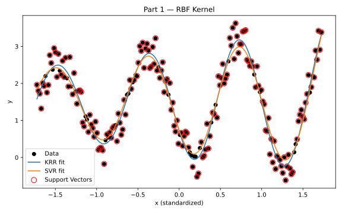

# Kernel Regression Comparison

Kernel ridge regression (KRR) and ε-support vector regression (SVR), implemented in NumPy with cvxopt solving the SVR quadratic program, and compared on three problems: a noisy sine curve, a housing price dataset, and string data using a custom 2-gram spectrum kernel.



## Experiments

- **Sine data**: KRR and SVR with polynomial and RBF kernels, showing which points SVR keeps as support vectors.
- **Housing prices** (`housing2r.csv`): a sweep over kernel hyperparameters, comparing a fixed regularization strength with one tuned by cross-validation, and tracking test MSE and the number of support vectors.
- **String data**: a 2-gram spectrum kernel against a simple character-count baseline, compared on test MSE.

The methods, results and discussion are in [`report/report.pdf`](report/report.pdf).

## Running it

```bash
pip install numpy pandas matplotlib scikit-learn cvxopt pytest
cd src
python kernels.py         # runs all three experiments and saves the plots
pytest test_kernels.py
```

## Layout

```
data/       sine, housing and string datasets
plots/      generated SVG plots for each experiment
report/     write-up (PDF)
src/        kernels.py (models and experiments), test_kernels.py
```

## License

MIT
